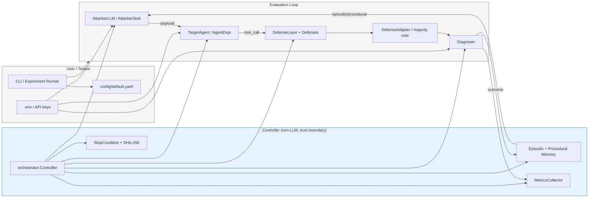

# Phase 1 — System Architecture

**Version:** 1.1
**Status:** Approved
**Last updated:** 2026-10-05

## 1. Overview

This document describes the architecture of the **Adaptive AI Agent Defense Evaluation Framework**.
It is the Phase 1 output for the project plan. It captures the component diagram, stack, folder
structure, third-party services, background jobs, and the riskiest decisions.

The architecture is a **research/evaluation framework**, not a production SaaS app. The controller
is non-LLM (ADR-001), stop conditions are checksummed (ADR-007), episodic memory is append-only
(ADR-004), and defense adapters use majority voting with deny-on-tie (ADR-005).

## 2. Component Diagram



## 3. Component Responsibilities

| Component | File | Responsibility |
|-----------|------|----------------|
| CLI / Experiment Runner | `adaptive_agent_eval/cli.py` | Builds experiment configs, drives mode selector |
| Controller | `adaptive_agent_eval/controller/orchestrator.py` | Non-LLM loop: attacker → target → defense → diagnoser → memory → metrics; checksummed stop conditions |
| Attacker | `adaptive_agent_eval/attacker/attacker_llm.py` | Generates adaptive payloads; hill-climbing over 5 categories; reads episodic + procedural memory |
| Target Agent | `adaptive_agent_eval/target/agent_dojo.py` | Wraps the target LLM agent; processes payloads and emits tool calls |
| Defense Layer | `adaptive_agent_eval/defense/defenses.py` | CaMeL, Progent, Verifier implementations |
| Defense Adapter | `adaptive_agent_eval/defense/adapter.py` | Normalizes events; majority voting with deny-on-tie |
| Diagnoser | `adaptive_agent_eval/diagnoser/diagnoser.py` | Stage A rule-based, Stage B LLM classifier; 10% human audit |
| Memory | `adaptive_agent_eval/memory/memory.py` | Episodic (append-only), procedural, working, semantic, prospective |
| Metrics | `adaptive_agent_eval/metrics/modules.py` | ASR, utility, bypass rate, propagation, cost per attack, rounds-to-success |
| Pipeline (offline) | `adaptive_agent_eval/pipelines/mode2_c1.py` | Deterministic stub pipeline for offline demo/testing |

## 4. Tech Stack

| Layer | Choice | Reason |
|-------|--------|--------|
| Language | Python 3.10+ | AI/research ecosystem, LLM tooling, fast prototyping |
| Runtime LLM provider | Hosted API (OpenAI/Anthropic) | No GPU; configurable fallback; ADR-013 / ADR-015 |
| LLM client | Official SDKs (openai, anthropic) | Direct API, well-documented, async support |
| Config | YAML (pydantic + ruamel) | Human-readable, version-controllable, nested |
| Validation | Pydantic v2 | Type-safe models, JSON-serializable |
| Persistence | JSON per episode | Git-friendly, append-only, no DB server needed |
| Metrics | pandas + numpy | Aggregation, CSV/JSON export, DataFrame ergonomics |
| Logging | Python `logging` (rich console) | Structured, no vendor lock-in |
| Linting/formatting | ruff | Fast, replaces flake8+isort+black |
| Testing | pytest + pytest-asyncio | Standard, excellent fixtures |
| Type checking | mypy | Static types, ADR-safe |
| CI/CD | GitHub Actions | Free for public repos |
| Auth / tenancy | Planned (v1 scope) | One user = one tenant; persisted in DB |

## 5. Folder Structure

```text
adaptive-agent-eval/
├── adaptive_agent_eval/
│   ├── __init__.py          # version
│   ├── cli.py               # CLI entry point
│   ├── models.py            # dataclasses + enums
│   ├── attacker/
│   │   ├── __init__.py
│   │   └── attacker_llm.py  # LLM attacker
│   ├── controller/
│   │   ├── __init__.py
│   │   └── orchestrator.py  # non-LLM loop
│   ├── defense/
│   │   ├── __init__.py
│   │   ├── defenses.py      # CaMeL / Progent / Verifier
│   │   └── adapter.py       # majority voting
│   ├── diagnoser/
│   │   ├── __init__.py
│   │   └── diagnoser.py
│   ├── memory/
│   │   ├── __init__.py
│   │   └── memory.py
│   ├── metrics/
│   │   ├── __init__.py
│   │   └── modules.py
│   ├── pipelines/
│   │   ├── __init__.py
│   │   └── mode2_c1.py      # offline stub pipeline
│   └── target/
│       ├── __init__.py
│       └── agent_dojo.py
├── config/
│   └── default.yaml
├── docs/
│   ├── CLAUDE.md
│   ├── PRD.md
│   ├── ARCHITECTURE_DECISIONS.md
│   ├── ARCHITECTURE_PROMPT.md
│   ├── DECISION_WORKFLOW_GUIDE.md
│   ├── EXAMINER_GUIDE.md
│   ├── EXPERIMENT_PLAN.md
│   ├── MEMORY_MAP.md
│   ├── METRICS_DEFINITIONS.md
│   ├── RESULTS_TEMPLATE.md
│   ├── SECURITY_HARDENING.md
│   ├── TESTING.md
│   └── decisions/
│       ├── system-design.md
│       └── phase1_architecture.md   # <-- this file
├── results/
│   └── mode2_c1/
├── frontend/          # orphaned, unreferenced — remove or ignore
├── tests/
│   └── test_models.py
├── pyproject.toml
├── requirements.txt
├── .gitignore
└── mcp.json           # orphaned, unreferenced — remove or ignore
```

## 6. Background Jobs

| Job | Purpose | Frequency | Notes |
|-----|---------|-----------|-------|
| Expiry sweep (90-day log retention) | Delete logs older than 90 days per tenant | On-demand / scheduled | Delete all tenant data on account removal |
| Metrics aggregation | Stream per-episode JSON → aggregate JSON/CSV | After each experiment | No in-memory pass |
| Deterministic seed / reproducibility | Re-run with same seed | On-demand | Pinned model IDs in config |
| Cost tracking | Log per-call token/cost | Every LLM call | Attached to episode result |

## 7. Third-Party Services

| Service | Purpose | Default | v1 Scope |
|---------|---------|---------|----------|
| OpenAI API | Attacker / target LLM | Yes | Enabled |
| Anthropic API | Attacker / target LLM (alt) | Yes | Enabled |
| PostgreSQL | Tenant-scoped data, auth, migrations | Planned | Out of v1 scope |
| Redis / object storage | Large log output (S3/R2) | Out of scope | Reserved |
| Auth.js / session | User/auth scaffolding | Planned | Out of v1 scope |
| Vercel / Railway + Neon/Supabase | Hosting | Planned | Out of v1 scope |
| GitHub Actions | CI/CD | Yes | Enabled |

## 8. Riskiest Decisions (and mitigations)

| Risk | Decision | Mitigation |
|------|----------|------------|
| LLM calls in controller | Non-LLM controller (ADR-001) | Static check: `grep -r "import openai\|import anthropic" controller/` |
| No GPU → no local Llama | Hosted API default (OpenAI) | Local/self-hosted is config-only, GPU-only fallback |
| Vendor lock-in | LLM client abstraction (ADR-013) | Swappable provider; model-agnostic interface |
| Stop-condition integrity | SHA-256 checksummed (ADR-007) | Verify checksum in tests and CI |
| Append-only episodic memory | In-memory + JSON file per episode (ADR-008) | No delete during episode; snapshot to disk |
| Defense composition voting | Majority voting, deny-on-tie (ADR-005) | Test tie → deny; log full evidence chain |
| Retention / deletion | 90-day log retention; purge o
